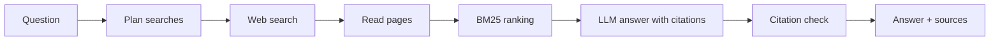

<p align="center">
  
</p>

<p align="center">
  An AI research agent that searches the web, reads the pages it finds and answers with citations it checks itself.
</p>

<p align="center">
  <a href="https://webresearchai.streamlit.app"><b>Try the live app →</b></a>
</p>

<p align="center">
  <a href="https://github.com/usman1905/research-agent/actions/workflows/ci.yml"></a>
</p>

## What it does

Ask a question in plain English. The agent:

1. **Plans** two to four web searches that cover the question.
2. **Searches** the web (DuckDuckGo, no API key needed) and removes duplicate and low-value results.
3. **Reads** each page and keeps only the main text.
4. **Ranks** every passage against the question with BM25 and keeps the strongest evidence, at most three passages per site.
5. **Answers** with an LLM that may only use the numbered sources, citing every fact like `[1]`.
6. **Checks** each cited sentence against the text of the source it cites. Citations to sources that don't exist are removed, and sentences whose key words aren't in their source are flagged for you to double-check.

The answer shows clickable citations, a source list and how many cited sentences passed the check.

## Tech

| Part | Tools |
| --- | --- |
| Interface | Streamlit |
| Search | DuckDuckGo via `ddgs` |
| Page reading | `httpx` + `trafilatura` |
| Ranking | BM25, written from scratch |
| Language model | Any OpenAI-compatible API: Groq (free tier, default), Gemini, OpenAI or a local server |
| Quality | pytest (18 tests, including an end-to-end app test), Ruff, GitHub Actions on Python 3.11 to 3.13 |



```
research-agent/
├── app.py               Streamlit interface
├── webresearch/
│   ├── agent.py         The research loop
│   ├── web.py           Search and page reading
│   ├── rank.py          BM25 passage ranking
│   ├── citations.py     Citation checking
│   ├── llm.py           OpenAI-compatible chat client
│   └── text.py          Tokens, sentences and passages
└── tests/               Unit tests and a full app test with a fake model
```

## Run it locally

Needs Python 3.11 or newer and a free API key from [Groq](https://console.groq.com).

```bash
pip install -r requirements.txt
cp .streamlit/secrets.toml.example .streamlit/secrets.toml   # add your key
streamlit run app.py
```

To use another provider, set `LLM_BASE_URL` and `LLM_MODEL` too, for example Gemini's OpenAI-compatible endpoint.

## Deploy for free

1. Sign in to [Streamlit Community Cloud](https://share.streamlit.io) with GitHub.
2. Create an app from this repository with `app.py` as the main file.
3. Under **Settings → Secrets**, add `LLM_API_KEY = "your-groq-key"`.

## Tests

```bash
pip install -r requirements-dev.txt
pytest -q
ruff check .
```

All tests run offline: the model, search and page reading are replaced with fakes.

## License

MIT. Built by [Muhammad Usman Shabbir](https://usman1905.github.io).
